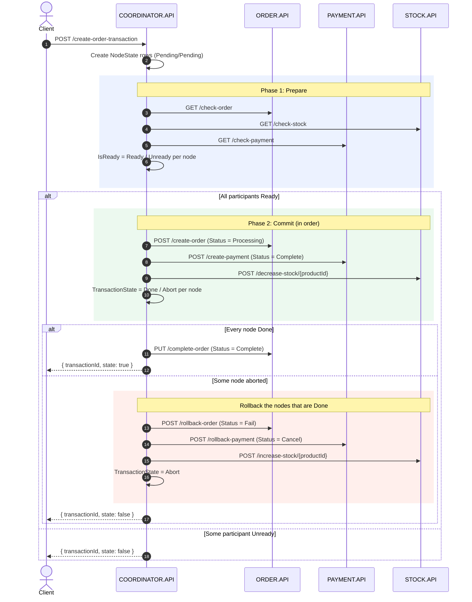

# Two-Phase Commit Pattern in .NET

A .NET 8 sample where a coordinator service drives a prepare/commit protocol over HTTP across Order, Payment and Stock services, and rolls back completed steps when any participant fails (ASP.NET Core minimal APIs, EF Core, SQL Server).


## Overview

Creating an order touches three services with three separate databases. The **Two-Phase Commit (2PC)** pattern brings them to a single outcome through a coordinator:

1. **Prepare.** The coordinator asks every participant whether it is ready, and records each vote.
2. **Commit.** Only if every participant voted *ready* does the coordinator tell each one to do its work. If any step fails, the coordinator **rolls back** the steps that already succeeded.

`COORDINATOR.API` persists the state of every transaction (`Nodes`, `NodeStates`, `TransactionDatas`), so you can see which participant voted what and which step committed or aborted.

> **Note:** This is an application-level, HTTP-based take on 2PC built for learning. Participants don't hold locks or open database transactions between the two phases. Each commit step is a normal local transaction, and rollback runs **compensating calls**, such as marking the order `Fail` or adding stock back. See [Design notes](#design-notes-and-trade-offs).

## Architecture

| Service | Default URL | Database | Endpoints |
|---|---|---|---|
| `COORDINATOR.API` | http://localhost:5201 (https://localhost:7243) | `CoordinatorDb` | `POST /create-order-transaction` |
| `ORDER.API` | https://localhost:5000 | `OrderDb` | `GET /check-order`, `POST /create-order`, `PUT /complete-order`, `POST /rollback-order` |
| `PAYMENT.API` | https://localhost:5001 | `PaymentDb` | `GET /check-payment`, `POST /create-payment`, `POST /rollback-payment` |
| `STOCK.API` | https://localhost:5002 | `StockDb` | `GET /check-stock`, `POST /decrease-stock/{productId}`, `POST /increase-stock/{productId}` |

The coordinator reads participant base URLs from `ServiceUrls` in `COORDINATOR.API/appsettings.json`.

### Transaction state

For every transaction, the coordinator creates one `NodeState` row per participant (`Order.API`, `Stock.API`, `Payment.API`):

| Column | Values | Meaning |
|---|---|---|
| `IsReady` | `Ready` (0), `Pending` (1), `Unready` (2) | The participant's vote in the prepare phase |
| `TransactionState` | `Done` (0), `Pending` (1), `Abort` (2) | Outcome of the participant's commit step |

### Flow



## Tech stack

- .NET 8, ASP.NET Core minimal APIs
- Entity Framework Core 8 with SQL Server (migrations included and applied on startup)
- `IHttpClientFactory` typed clients wrapped by proxy classes (`ClientProxies/`)
- Swagger / Swashbuckle (Development environment)

## Project structure

```text
TwoPhaseCommitPattern.sln
docker-compose.yml                 # SQL Server for local development
Services/
├── COORDINATOR.API/
│   ├── ITransactionService.cs     # Prepare, commit, state checks, rollback
│   ├── ClientProxies/             # IOrderProxy, IPaymentProxy, IStockProxy
│   ├── Clients/                   # HttpClient wrappers for each participant
│   ├── Entities/                  # Node, NodeState, TransactionData
│   ├── Enums/, Models/, Migrations/
│   └── Program.cs                 # POST /create-order-transaction
├── ORDER.API/                     # Orders: create, complete, rollback
├── PAYMENT.API/                   # Payments: create, rollback (cancel)
└── STOCK.API/                     # Stock: decrease, increase
```

## Getting started

### Prerequisites

- [.NET 8 SDK](https://dotnet.microsoft.com/download) or newer
- Docker (for SQL Server)
- A trusted ASP.NET Core HTTPS development certificate for the participant services: `dotnet dev-certs https --trust`

### 1. Start SQL Server

```bash
docker compose up -d
```

SQL Server listens on `localhost,1433` with `sa` / `Your_password123`. This is a **local development default only** that matches the `DefaultConnection` strings in each service's `appsettings.json`. You can override it with `ConnectionStrings__DefaultConnection`.

> The SQL Server image is `linux/amd64`. On Apple Silicon it runs through Docker Desktop's Rosetta emulation.

### 2. Run the services

Each service applies its migrations on startup. `STOCK.API` seeds products `1` (100), `2` (50) and `3` (10) when its table is empty, and the coordinator's migration seeds the three participant nodes.

```bash
dotnet run --project Services/ORDER.API
dotnet run --project Services/PAYMENT.API
dotnet run --project Services/STOCK.API
dotnet run --project Services/COORDINATOR.API --launch-profile http   # http://localhost:5201/swagger
```

> **macOS:** port 5000 is usually taken by the AirPlay Receiver. Either turn it off, or move ORDER.API and point the coordinator at it:
>
> ```bash
> dotnet run --project Services/ORDER.API --urls https://localhost:5010
> ServiceUrls__OrderApi=https://localhost:5010/ dotnet run --project Services/COORDINATOR.API --launch-profile http
> ```

### 3. Send requests

**Commit.** Product 1 exists, so all three nodes end `Done` and the order becomes `Complete`:

```bash
curl -X POST http://localhost:5201/create-order-transaction \
  -H "Content-Type: application/json" \
  -d '{ "customerName": "John Doe", "customerEmail": "john.doe@example.com", "productId": 1 }'
# => { "transactionId": "…", "state": true }
```

**Rollback.** Product 99 doesn't exist, so the stock step aborts. The order is rolled back to `Fail` and the payment to `Cancel`:

```bash
curl -X POST http://localhost:5201/create-order-transaction \
  -H "Content-Type: application/json" \
  -d '{ "customerName": "John Doe", "customerEmail": "john.doe@example.com", "productId": 99 }'
# => { "transactionId": "…", "state": false }
```

Both requests are in `Services/COORDINATOR.API/COORDINATOR.API.http`. Inspect `CoordinatorDb.dbo.NodeStates` to see each node's vote and outcome.

## Design notes and trade-offs

- **Persistent coordinator log.** Votes and outcomes are stored per node and per transaction. This is what a real coordinator needs in order to recover after a crash, although no recovery process is implemented here.
- **Ordered commit.** Steps run in a fixed order: Order, then Payment, then Stock. Payment and Stock only run if the order was created, because they need its id and product.
- **Rollback by compensation.** Classic 2PC keeps participants' transactions open, holding locks, until the coordinator's decision arrives. Here each participant commits locally right away, and "rollback" means calling an inverse operation. That avoids long-held locks and works over plain HTTP, but intermediate states (for example, an order in `Processing`) are visible to other readers. Semantically it sits close to an orchestrated saga.
- **Synchronous HTTP.** The client gets the final outcome in the same request. The coordinator becomes a latency and availability bottleneck in exchange.
- **Configurable participant URLs.** These live in `ServiceUrls`, so services can be moved without code changes.

## Known limitations

This is a learning sample, not production code:

- **The prepare phase is not a real vote.** `check-order`, `check-payment` and `check-stock` always return `true`. Stock availability isn't checked, and quantities can go negative.
- **No timeouts, retries or crash recovery.** If the coordinator dies between phases, the transaction stays `Pending` and nothing resumes it.
- **Compensating calls are best effort.** A failed rollback call is only recorded as `Abort`, with no retry.
- **No idempotency.** Calling `increase-stock` twice adds stock twice.
- **TLS validation is disabled** in the coordinator's HTTP clients, to make the local dev certificates work.
- No authentication, input validation, health checks or automated tests.

## License

This project is licensed under the [MIT License](LICENSE).
